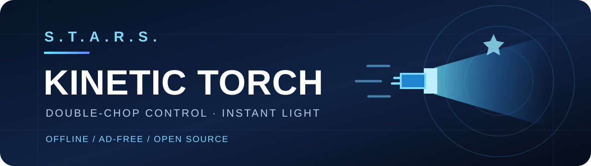
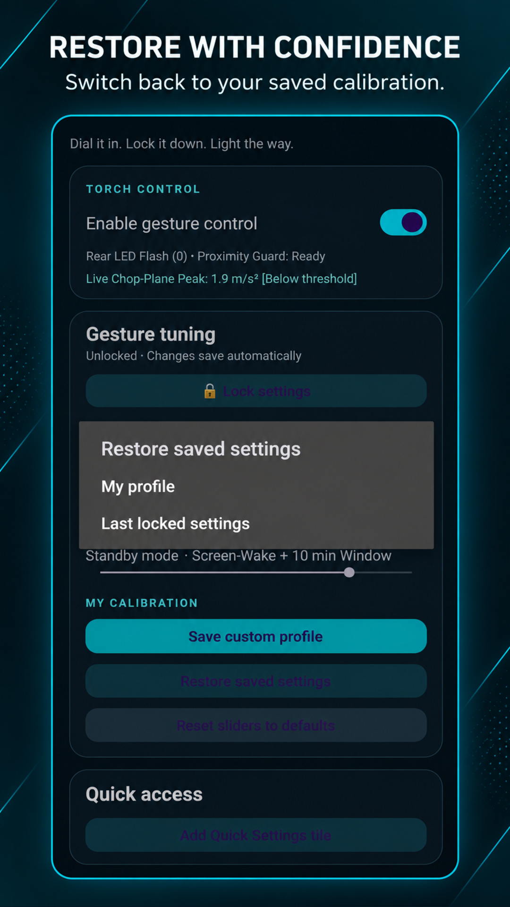

  

<h1 align="center">S.T.A.R.S. Kinetic Torch</h1>

  <strong>Two chops. Light on. Two chops. Light off.</strong> 
  A customizable Android flashlight gesture utility. No ads, accounts, or internet connection required.

  
  &nbsp; <strong>Android 8.0+</strong> &nbsp;·&nbsp; <strong>AGPL-3.0-only</strong> &nbsp;·&nbsp; <strong>v1.3.6 candidate</strong>

  <a href="#preview">Screenshots</a> ·
  <a href="#features">Features</a> ·
  <a href="#get-and-test">Get &amp; test</a> ·
  <a href="#compatibility">Compatibility</a> ·
  <a href="#for-developers">Developers</a>

> **Release status:** Version **1.3.5 (code 20)** is in Google Play **internal testing** (per the project owner). Version **1.3.6 (code 21)** is a new build candidate, not yet uploaded. The [F-Droid submission](https://gitlab.com/fdroid/fdroiddata/-/merge_requests/57530) is closed pending a March 1, 2027 retry. Neither listing is a generally available public release.

## Preview

The six approved v1.3.5 screenshots show the redesigned app. Tap any image to see it full size.

  
  
  

  
  
  

## Features

| Light when you need it | Control on your terms |
| --- | --- |
| **Double-chop toggle** — switch the rear LED flashlight on or off with a deliberate motion. | **Fine-tune your gesture** — adjust force and timing, including fast movements. |
| **Protect against accidental activation** — proximity guard and automatic shutoff timer. | **Save your setup** — named profiles, reset-to-defaults, and a lock to prevent unwanted settings changes. |
| **Stay in control** — Quick Settings tile, foreground listening notification, and haptic feedback. | **Stay private** — no advertising, account, telemetry, or internet permission. |

### How it works

1. Open Kinetic Torch on a compatible Android phone and enable gesture listening.
2. Make two quick chopping motions to toggle the phone's **rear LED flashlight**.
3. Adjust the timing and sensitivity to suit your movement. Save and lock a profile when it feels right.

The white-screen torch mode was retired; this release uses the **hardware flash LED only**.

## Get and test

| Channel | Current state | Where to go |
| --- | --- | --- |
| **Google Play** | 1.3.5 internal test; access requires an approved invitation. | **Already a tester?** Use your existing Google Play testing invitation. |
| **F-Droid** | Source submitted; awaiting F-Droid review, build, and signing. | [Follow submission !57530](https://gitlab.com/fdroid/fdroiddata/-/merge_requests/57530) |
| **Source code** | Public development repository; AGPLv3. | [Browse source](https://github.com/NPFS42/Kinetic-Torch) · [Change history](CHANGELOG.md) |

**Want to help test?** [Open a beta-tester request](https://github.com/NPFS42/Kinetic-Torch/issues/new?title=Kinetic%20Torch%20beta%20tester%20request) with your phone model and Android version. GitHub issues are public, so **don't post private contact information**. We especially value reports about missed chops, false activations, and background battery use.

> **Please note:** GitHub Actions debug APKs and unsigned build artifacts are for development/acceptance testing, **not official Play or F-Droid releases**. For F-Droid-flavor device-testing instructions, see the [distribution guide](docs/DISTRIBUTION_STREAMS.md).

## Compatibility

- **Android 8.0 (API 26) or later**, with a functioning rear hardware flash LED.
- Gesture reliability varies by device, sensor, battery management, and manufacturer; **1.3.5's new profiles and settings lock still need hardware acceptance tests**.
- **Motorola / Moto devices are intentionally excluded in-app** to avoid conflicts with the manufacturer's built-in chop gesture. Store-side exclusions are tracked separately.
- When testing Play and F-Droid variants side by side, **arm only one gesture listener at a time**.

See the [acceptance checklist](docs/SETTINGS_PROFILES_ACCEPTANCE.md) and [compatibility notes](docs/MOTOROLA_EXCLUSION_AND_DEFAULTS.md).

## Privacy and openness

Kinetic Torch works offline without an account and does not request internet access. Debug builds can collect **local** diagnostics for troubleshooting; release builds have diagnostic recording disabled. See the [privacy policy](https://sovereignresearch.net/kinetic-torch-privacy.html), [license](LICENSE), [source and artwork scope](LICENSE-SCOPE.md), and [artwork/trademark terms](ARTWORK-AND-TRADEMARKS.md).

## For developers

- [Build instructions and separate Play / F-Droid identities](docs/DISTRIBUTION_STREAMS.md)
- [Changelog](CHANGELOG.md)
- [Report a bug or request a feature](https://github.com/NPFS42/Kinetic-Torch/issues)
- [Security policy](SECURITY.md)

<strong>Expand engineering notes, historical source recovery, and release requirements</strong>

## Current development source: 1.3.6 (versionCode 21; release candidate)

Two distribution flavors share this source: Google Play uses the existing package `com.npfs.stars.kinetictorch`, while F-Droid uses `com.npfs.stars.kinetictorch.fdroid`. Both use minSdk 26, targetSdk 36, compileSdk 36, and Java/Kotlin 17. Debug variants append `.debug` to their respective package IDs. See [distribution streams](docs/DISTRIBUTION_STREAMS.md).

**LED-only release candidate:** The white-screen torch is deprecated and no longer reachable.
Its settings switch, full-screen-intent permission, manifest activity, service routing, and
automatic fallback are disabled/commented out; the implementation is retained in source.
Devices without a hardware flash LED cannot arm Kinetic Torch. An old saved white-screen
preference does not restore it. See [deprecation notes](docs/SCREEN_TORCH_DEPRECATION.md).

Version 1.3.6 builds on 1.3.5 with the rolling vibration guard and tabbed interface. Version 1.3.5 introduced the calibration lock, saved/restorable profiles, redesigned settings, and 5.0 m/s² slider minimum. The owner confirmed LED ON/OFF and haptic feedback in RC6 of 1.3.3; the new 1.3.6 vibration behavior still requires hardware testing.

- Gesture defaults: **12 m/s²**, **750 ms**; Reset sliders restores those and the other slider defaults without changing arm state.
- More forgiving OFF gesture: **75%** of configured force, **+250 ms** timing allowance; adjusted inter-chop quiet-valley detector with a 200 ms recoil guard.
- Vibration: **two 240 ms pulses** for ON; **one 220 ms pulse** for OFF after OS LED-off confirmation, classified as Android hardware feedback.
- Proximity blocks covered accidental ON but never prevents deliberate OFF of an active torch.
- **Unreleased vibration guard:** repeated rapid motion (washboard roads or strong bass transmitted through a phone mount) pauses gesture recognition for 30 seconds, restarting the timer with each newly qualified vibration. The phone must physically vibrate; the app does not listen to audio or inspect Spotify. The existing calibration stays unchanged. Hardware testing is still required.
- **Unreleased tabbed UI:** Main holds Torch control and Quick access; Gesture Tuning holds the sliders, settings lock, and saved profiles. Navigation stays visible at the top while scrolling, and tab selection is restored after activity recreation.
- Motorola/Moto gestures are disabled in-app to avoid conflicting with the OEM feature; store-side model exclusions remain a separate Play Console task.
- The settings respect modern Android status/navigation insets.
- Debug builds record local diagnostic events; release builds disable diagnostic recording via `BuildConfig.DIAGNOSTICS_ENABLED=false`. No internet account or data transfer is required.

See [CHANGELOG.md](CHANGELOG.md) and [docs/MOTOROLA_EXCLUSION_AND_DEFAULTS.md](docs/MOTOROLA_EXCLUSION_AND_DEFAULTS.md) for implementation and validation notes.

## Build and distribution

The GitHub Actions workflow tests both flavors and builds unsigned release candidates for each distribution, plus Play debug/diagnostic variants. Debug and unsigned CI artifacts are **not** store updates. Version 1.3.5/code 20 remains the reported Play internal-test release; version 1.3.6/code 21 is a source/build candidate, not a Play deployment. The [original F-Droid submission !57530](https://gitlab.com/fdroid/fdroiddata/-/merge_requests/57530) was closed, with resubmission deferred until March 1, 2027.

Configure the original app signing or Play upload keystore through private environment variables `KINETIC_KEYSTORE_PATH`, `KINETIC_KEYSTORE_PASSWORD`, `KINETIC_KEY_ALIAS`, and `KINETIC_KEY_PASSWORD` on the trusted release machine; never commit keys or passwords. Build the Play AAB with `:app:bundlePlayRelease`. F-Droid builds `:app:assembleFdroidRelease` from a tagged source revision and signs independently. Moving source to `main` does not deploy either store update.

## Historical source recovery

On November 2, 2026, recovered working source was imported as version 1.3.0/code 4. An alternate tree is retained in `historical/downloaded-v1_3_1/`; its archive name is not proof of the APK's actual version. The earlier assessment at `docs/LOCAL_RECOVERY_2026-11-02.md` and `docs/UPLOAD_ANALYSIS_2026-11-02.md` is historical and predates the 1.3.3 device testing.

## Software, artwork and trademark permissions

Original project-owned software source uses **GNU AGPL version 3 only** (`AGPL-3.0-only`). See [LICENSE](LICENSE), [license scope and third-party exclusions](LICENSE-SCOPE.md), and the [specific grant for original visual artwork and official-brand redistribution](ARTWORK-AND-TRADEMARKS.md). Prior grants remain valid for historical releases; names and trademarks remain reserved as identifiers of origin, and third-party/private material is not relicensed. Licensing a source file does not deploy or release software.

## AGPL Android source access and release gate

The current Android settings screen includes a **Source code & AGPLv3 license** button. It opens the public source repository using a user-initiated browser intent and does not grant the app network permissions. The complete AGPLv3 text is packaged in `app/src/main/assets/COPYING`.

Future signed APK/AAB releases must be matched to an exact tagged source revision, with dependency notices and a clean source package. See [AGPL release gate](docs/AGPL_RELEASE_GATE.md). These source changes are not an Android release; earlier GPLv3 releases keep their prior grants.

