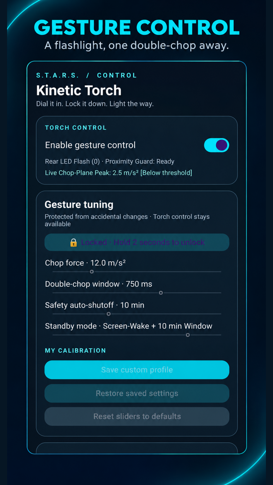
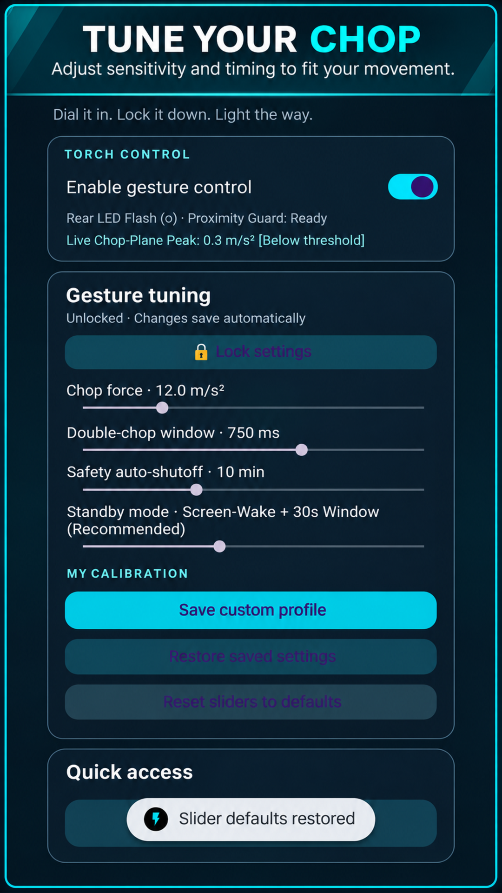
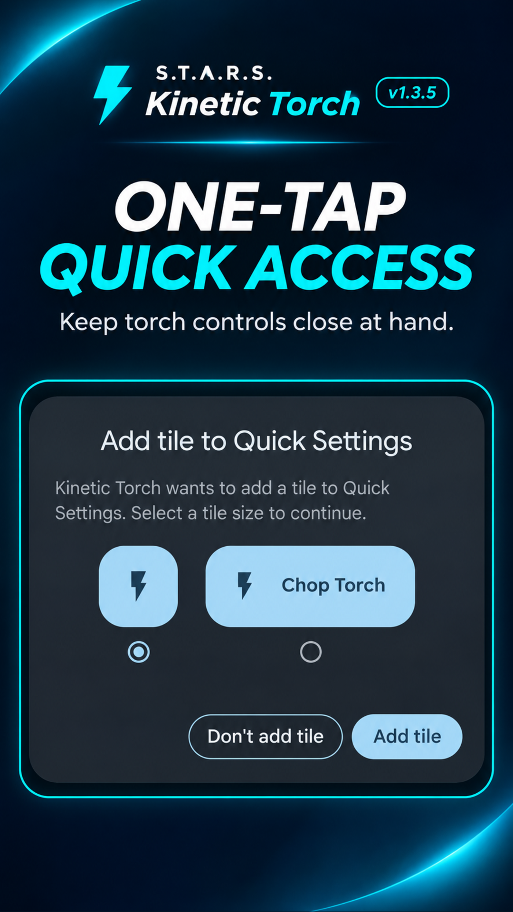
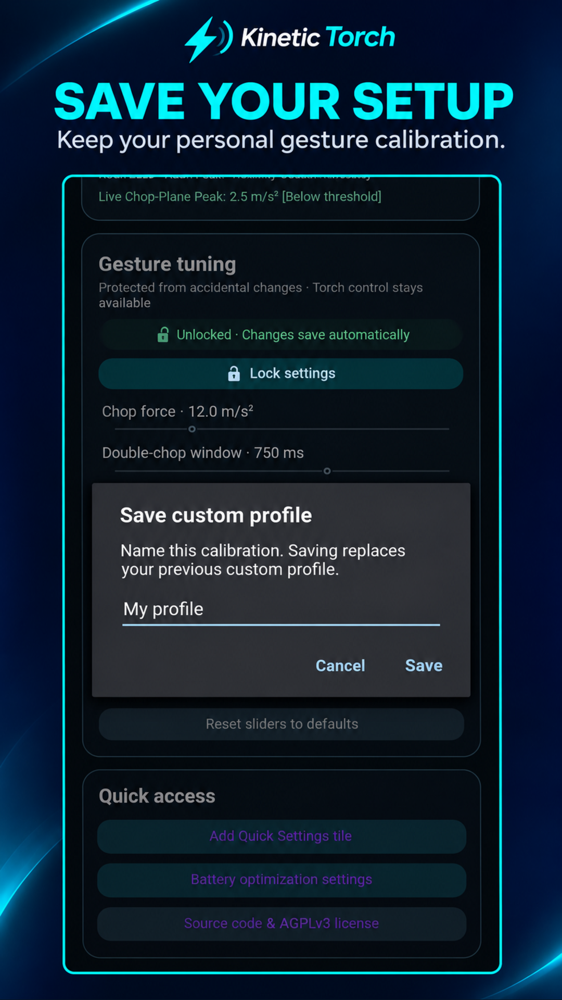
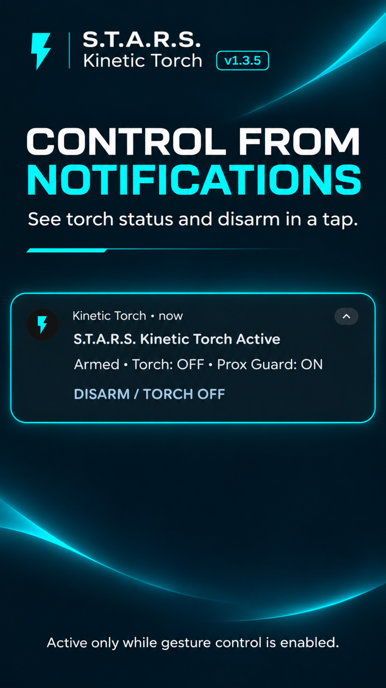

# S.T.A.R.S. Kinetic Torch

Offline, ad-free Android flashlight utility with double-chop gesture control, hardware LED flash, and a Quick Settings tile.

## App preview

Explore the latest v1.3.5 interface. Select any screenshot to open it full size.

  
  
  

  
  
  

*These are the six approved release screenshots; the retired white-screen torch option is not shown.*

## Current development source: 1.3.5 (versionCode 20; internal testing)

Two distribution flavors share this source: Google Play uses the existing package `com.npfs.stars.kinetictorch`, while F-Droid uses `com.npfs.stars.kinetictorch.fdroid`. Both use minSdk 26, targetSdk 36, compileSdk 36, and Java/Kotlin 17. Debug variants append `.debug` to their respective package IDs. See [distribution streams](docs/DISTRIBUTION_STREAMS.md).

**LED-only release candidate:** The white-screen torch is deprecated and no longer reachable.
Its settings switch, full-screen-intent permission, manifest activity, service routing, and
automatic fallback are disabled/commented out; the implementation is retained in source.
Devices without a hardware flash LED cannot arm Kinetic Torch. An old saved white-screen
preference does not restore it. See [deprecation notes](docs/SCREEN_TORCH_DEPRECATION.md).

Version 1.3.5 builds on the signed 1.3.4 LED-only candidate and adds a calibration lock, saved/restoreable local profiles, a redesigned settings screen, and a 5.0 m/s² force-slider minimum. The 1.3.4 signed APK/AAB remain unchanged. The owner confirmed both LED ON/OFF and haptic feedback in RC6 of 1.3.3; these new settings features still require hardware testing.

- Gesture defaults: **12 m/s²**, **750 ms**; Reset sliders restores those and the other slider defaults without changing arm state.
- More forgiving OFF gesture: **75%** of configured force, **+250 ms** timing allowance; adjusted inter-chop quiet-valley detector with a 200 ms recoil guard.
- Vibration: **two 240 ms pulses** for ON; **one 220 ms pulse** for OFF after OS LED-off confirmation, classified as Android hardware feedback.
- Proximity blocks covered accidental ON but never prevents deliberate OFF of an active torch.
- Motorola/Moto gestures are disabled in-app to avoid conflicting with the OEM feature; store-side model exclusions remain a separate Play Console task.
- The settings respect modern Android status/navigation insets.
- Debug builds record local diagnostic events; release builds disable diagnostic recording via `BuildConfig.DIAGNOSTICS_ENABLED=false`. No internet account or data transfer is required.

See [CHANGELOG.md](CHANGELOG.md) and [docs/MOTOROLA_EXCLUSION_AND_DEFAULTS.md](docs/MOTOROLA_EXCLUSION_AND_DEFAULTS.md) for implementation and validation notes.

## Build and distribution

The GitHub Actions workflow tests both flavors and builds unsigned release candidates for each distribution, plus Play debug/diagnostic variants. Debug and unsigned CI artifacts are **not** store updates. Version 1.3.5/code 20 has been released to Play internal testing; the separate F-Droid submission is now [open for review as merge request !57530](https://gitlab.com/fdroid/fdroiddata/-/merge_requests/57530).

Configure the original app signing or Play upload keystore through private environment variables `KINETIC_KEYSTORE_PATH`, `KINETIC_KEYSTORE_PASSWORD`, `KINETIC_KEY_ALIAS`, and `KINETIC_KEY_PASSWORD` on the trusted release machine; never commit keys or passwords. Build the Play AAB with `:app:bundlePlayRelease`. F-Droid builds `:app:assembleFdroidRelease` from a tagged source revision and signs independently. Moving source to `main` does not deploy either store update.

## Historical source recovery

On November 2, 2026, recovered working source was imported as version 1.3.0/code 4. An alternate tree is retained in `historical/downloaded-v1_3_1/`; its archive name is not proof of the APK's actual version. The earlier assessment at `docs/LOCAL_RECOVERY_2026-11-02.md` and `docs/UPLOAD_ANALYSIS_2026-11-02.md` is historical and predates the 1.3.3 device testing.

## Software, artwork and trademark permissions

Original project-owned software source uses **GNU AGPL version 3 only** (`AGPL-3.0-only`). See [LICENSE](LICENSE), [license scope and third-party exclusions](LICENSE-SCOPE.md), and the [specific grant for original visual artwork and official-brand redistribution](ARTWORK-AND-TRADEMARKS.md). Prior grants remain valid for historical releases; names and trademarks remain reserved as identifiers of origin, and third-party/private material is not relicensed. Licensing a source file does not deploy or release software.

## AGPL Android source access and release gate

The current Android settings screen includes a **Source code & AGPLv3 license** button. It opens the public source repository using a user-initiated browser intent and does not grant the app network permissions. The complete AGPLv3 text is packaged in `app/src/main/assets/COPYING`.

Future signed APK/AAB releases must be matched to an exact tagged source revision, with dependency notices and a clean source package. See [AGPL release gate](docs/AGPL_RELEASE_GATE.md). These source changes are not an Android release; earlier GPLv3 releases keep their prior grants.
